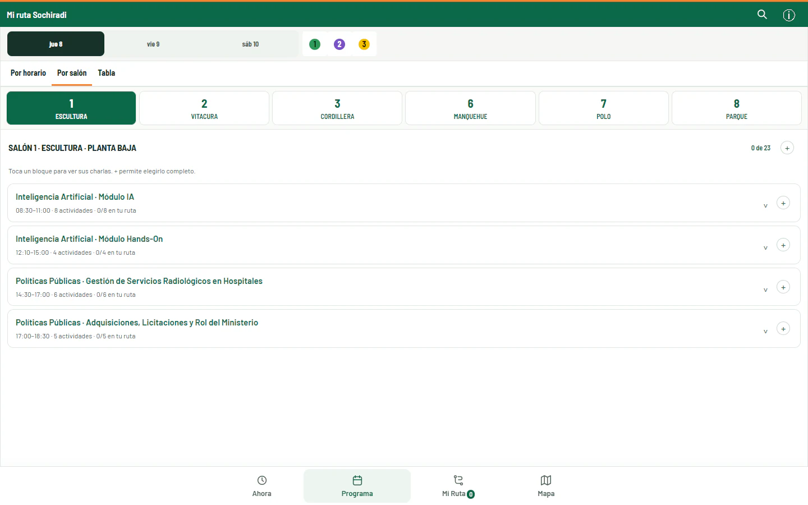

# Mi ruta SOCHIRADI

[English](README.md) · **Español**

**Tu programa del congreso, convertido en una ruta personal.**

Agenda y mapa no oficiales del Congreso Chileno de Radiología 2026. Aplicación web pensada para explorar las actividades desde el teléfono, elegir qué ver y detectar superposiciones de horario.

[Abrir la aplicación](https://mi-ruta-sochiradi.pablo-aguirre-araya.workers.dev/)

<picture>
  <source media="(max-width: 600px)" srcset="assets/screenshots/programa-mobile.webp">
  
</picture>

App publicada, 22 de octubre de 2026. Vista Programa abierta con la navegación normal; sin alterar el reloj ni los datos de la agenda. [Móvil (390 × 844, escala 2)](assets/screenshots/programa-mobile.webp) · [Procedencia de las capturas](assets/screenshots/README.md).

**Estado:** app independiente publicada; congreso finalizado. Las capturas muestran consulta del programa, no un evento en curso.

## El problema

Un congreso con actividades simultáneas exige comparar horarios, salones y temas para decidir a qué asistir. El proyecto transforma el programa en una experiencia de consulta y selección que conserva una ruta personal durante el evento.

## Qué permite hacer

- Explorar el programa por horario o salón, con filtros y búsqueda.
- Elegir actividades y bloques para construir una ruta propia.
- Detectar conflictos entre actividades seleccionadas.
- Consultar el mapa y los detalles de las charlas.
- Conservar las elecciones en el navegador y consultar la agenda sin conexión después de la carga inicial.

## Uso registrado durante el congreso

Cloudflare Web Analytics mostró los siguientes valores para el **9 y 10 de octubre de 2026**, en horario de Chile continental (GMT−3), con el filtro de bots activado:

| Indicador | Valor aproximado |
| --- | --- |
| Visitas | 140 |
| Páginas vistas | 1.200 |
| Dispositivo registrado | 100 % móvil |
| País registrado | 100 % Chile |
| Día de mayor actividad de los dos medidos | 9 de octubre: 100 visitas y 800 páginas vistas |

undefined Las visitas no equivalen a personas únicas, y las páginas vistas incluyen cambios de vista dentro de la app. Estas cifras muestran actividad registrada durante el evento; no permiten calcular cuántos asistentes distintos la utilizaron ni cuánto tiempo ahorraron. [Metodología de Cloudflare](https://developers.cloudflare.com/web-analytics/faq/).

## Evidencia inspeccionable

- [Auditoría del programa](docs/data-audit.md): cobertura, fuentes y discrepancias.
- [Verificación de la aplicación](docs/verification.md): comprobaciones documentadas y limitaciones.
- [Capturas reales y parámetros](assets/screenshots/README.md): sesión nueva, sin rutas personales preexistentes.

## Mi aporte

**Dr. Pablo Aguirre Araya, médico general de zona en Arica.** Definición de la necesidad, decisiones de experiencia de uso, preparación y revisión del programa, y desarrollo iterativo con apoyo de IA.

## Tecnología y estado

HTML, CSS y módulos JavaScript; aplicación web instalable con almacenamiento local y caché para consulta sin conexión. Publicada en Cloudflare Workers.

El congreso finalizó; el programa y la ruta guardada siguen disponibles para consulta. La app es un proyecto independiente, no una aplicación oficial de SOCHIRADI.

## Límites

Las elecciones se guardan por navegador y dominio, sin cuentas ni sincronización entre dispositivos. La primera carga requiere conexión. El PDF del programa y las imágenes externas pueden requerir conexión adicional. Las fuentes y materiales del congreso conservan su procedencia y derechos correspondientes.

## Desarrollo local

Requiere Node.js moderno, sin dependencias de ejecución.

```sh
npm run dev
npm test
npm run check
npm run validate
npm run build
```

El servidor local abre en `http://127.0.0.1:4173`. La distribución estática está en `dist/`. El repositorio existente conserva documentación adicional de fuentes, conciliación del programa, pruebas y publicación.

[Contacto](mailto:pablo.aguirre.araya@gmail.com)
