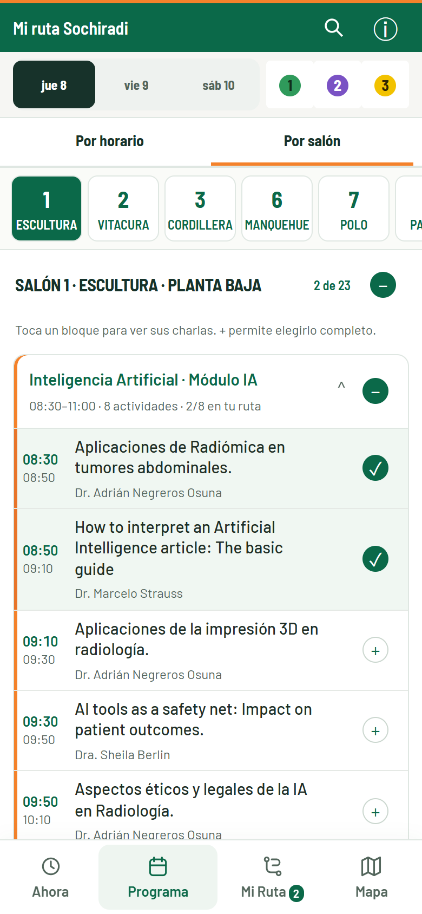

# Mi ruta SOCHIRADI

[Read in English](README.md) · **Español**

**Del programa del congreso a un itinerario personal.**

Agenda móvil no oficial para el Congreso Chileno de Radiología 2026: comparar sesiones simultáneas, elegir actividades y reconocer conflictos de horario desde el teléfono.

[Explorar el programa](https://mi-ruta-sochiradi.pablo-aguirre-araya.workers.dev/) · [Fuentes y auditoría de datos](docs/data-audit.md)

**Desplegada y utilizada durante el evento.** El congreso terminó; su programa sigue disponible como referencia.



*Captura móvil real, 390 × 844 píxeles CSS. Dos selecciones de ejemplo; interfaz en español.*

## De elegir a asistir

- Explorar por horario o salón, con búsqueda y filtros.
- Elegir charlas, bloques o salas, conservando excepciones individuales.
- Consultar un itinerario cronológico, solapamientos y cambios de sala.
- Revisar el plano del recinto y los detalles de las charlas.
- Guardar elecciones localmente y consultar la agenda en caché sin conexión tras una primera carga correcta.


## Evidencia histórica de uso

Cloudflare Web Analytics registró aproximadamente **140 visitas y 1.200 páginas vistas el 9–10 de octubre de 2026**, en horario de Chile continental (GMT−3), con filtrado de bots activado.

| Medida histórica | Valor aproximado |
| --- | --- |
| 9 de octubre | 100 visitas · 800 páginas vistas |
| 10 de octubre | 40 visitas · 400 páginas vistas |
| Dispositivo / país informado | 100% móvil / 100% Chile |

Las cifras históricas pueden ser muestreadas. Las visitas **no equivalen a personas únicas**; las páginas vistas incluyen navegación interna. Evidencian actividad registrada, no cantidad de asistentes distintos ni ahorro de tiempo medido. [Notas de medición](https://developers.cloudflare.com/web-analytics/faq/).

## Ejecutar y revisar

HTML, CSS y módulos JavaScript; almacenamiento local, caché sin conexión y alojamiento en Cloudflare Workers. Sin dependencias de ejecución. Con una versión moderna de Node.js:

```sh
npm run dev
npm test
npm run check
npm run validate
npm run build
```

El servidor de desarrollo usa el puerto 4173; los archivos estáticos están en `dist/`. [Verificación](docs/verification.md) conserva los controles técnicos existentes. Esta actualización de presentación solo cambia documentación y capturas.

## Alcance y aporte

Proyecto independiente, no una app oficial de SOCHIRADI. Las selecciones pertenecen a cada navegador y dominio, sin cuentas ni sincronización; la primera carga y los materiales externos requieren conexión. Se conserva la procedencia y los derechos de las fuentes.

Definí la necesidad y la experiencia móvil, preparé y revisé los datos del programa y desarrollé iterativamente con asistencia de IA. **Pablo Aguirre Araya, médico en Chile.**

[Abrir la app](https://mi-ruta-sochiradi.pablo-aguirre-araya.workers.dev/) · [Contacto](mailto:pablo.aguirre.araya@gmail.com) · [Detalles de las capturas](docs/screenshots.md)
