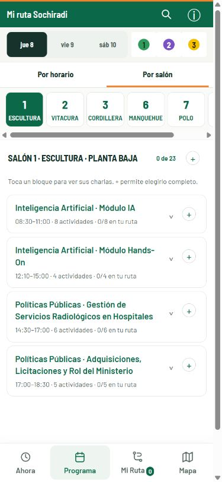

# Mi ruta SOCHIRADI

**English** · [Leer en español](README.es.md)

**A conference program you can turn into your own itinerary.**

An unofficial mobile web agenda and venue map for the 2026 Chilean Radiology Congress. Built to help attendees explore simultaneous sessions, choose activities and spot scheduling conflicts from their phones.

[Open the app](https://mi-ruta-sochiradi.pablo-aguirre-araya.workers.dev/) · [View the repository](https://github.com/pabloagar/mi-ruta-sochiradi)



*Mobile browser capture. The app interface is in Spanish.*

## The problem

A conference with simultaneous sessions requires comparing times, rooms and topics to decide what to attend. This project turns the program into an interactive agenda that keeps a personal itinerary throughout the event.

## What it does

- Browse the program by time or room, with search and filters.
- Select activities and session blocks to build a personal itinerary.
- Identify overlapping activities.
- View the venue map and talk details.
- Keep selections in the browser and consult the cached agenda offline after the initial load.

## Recorded use during the conference

Cloudflare Web Analytics showed the following figures for **October 9–10, 2026**, in mainland Chile time (GMT−3), with bot filtering enabled:

| Metric | Approximate result |
| --- | --- |
| Visits | 140 |
| Page views | 1,200 |
| Recorded device type | 100% mobile |
| Recorded country | 100% Chile |
| Busiest of the two measured days | October 9: 100 visits and 800 page views |

Historical figures may be sampled. Visits are not unique people, and page views include navigation within the app. These figures show recorded activity during the event; they do not establish how many distinct attendees used the app or how much time it saved. [Cloudflare methodology](https://developers.cloudflare.com/web-analytics/faq/).

## My contribution

**Dr. Pablo Aguirre Araya, physician in Chile's MGZ public service program, Arica.** Problem definition, user experience decisions, preparation and review of the program data, and iterative development with AI assistance.

## Technology and status

HTML, CSS and JavaScript modules; an installable web app with local storage and offline caching. Deployed on Cloudflare Workers.

The conference has ended; the program and saved itinerary remain available for reference. This is an independent project, not an official SOCHIRADI application.

## Limitations

Selections are stored per browser and domain, without accounts or cross-device synchronization. The first load requires connectivity. The program PDF and external images may need a separate online connection. Conference source materials retain their respective provenance and rights.

## Local development

Requires a modern Node.js version, with no runtime dependencies.

```sh
npm run dev
npm test
npm run check
npm run validate
npm run build
```

The local server runs at `http://127.0.0.1:4173`. Static distribution files are in `dist/`. The existing repository contains additional documentation on sources, program reconciliation, checks and deployment.

[Contact](mailto:pablo.aguirre.araya@gmail.com)
